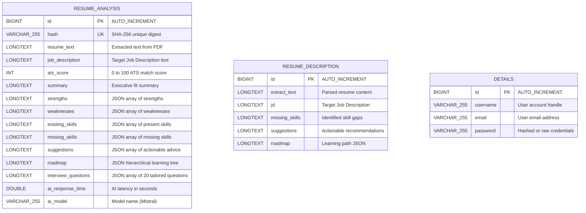

# 🗄️ CareerForge — Database Architecture & Schema Documentation

This document provides a comprehensive guide to the database architecture, entity relational models, table schemas, indexing strategies, setup instructions, and sample SQL queries for the **CareerForge** platform.

---

## 📌 Database Overview

The system uses **MySQL 8.0+** as its primary relational database managed via **Spring Data JPA / Hibernate ORM** in the Spring Boot backend (`Ai_resume_analyzer`).

- **Database Engine:** MySQL InnoDB (supports ACID compliance, foreign keys, row-level locking)
- **Database Name:** `resume_analyzer`
- **Default Port:** `3306`
- **Hibernate Dialect:** `org.hibernate.dialect.MySQLDialect`
- **Schema Auto-DDL Strategy:** `update` (`spring.jpa.hibernate.ddl-auto=update`)
- **Character Set & Collation:** `utf8mb4` / `utf8mb4_unicode_ci` (supports full Unicode & emojis)

---

## 🏗️ Entity Relationship Diagram (ERD)



---

## 📋 Table Schemas & Data Dictionary

### 1. `resume_analysis` Table

This is the **core entity** that powers the AI Resume Analyzer, ATS score computation, dynamic roadmap generator, and tailored interview question generator. It includes a SHA-256 hash column for intelligent caching.

| Column Name | SQL Type | Constraints | Description |
|:---|:---|:---|:---|
| `id` | `BIGINT` | `PRIMARY KEY`, `AUTO_INCREMENT` | Unique identifier for each analysis record |
| `hash` | `VARCHAR(255)` | `UNIQUE`, `NOT NULL` | SHA-256 cryptographic digest of `(resumeText + jobDescription)` for instant cache hits |
| `resume_text` | `LONGTEXT` | `NULLABLE` | Full plain text stripped from the user's uploaded PDF resume via Apache PDFBox |
| `job_description`| `LONGTEXT` | `NULLABLE` | Target Job Description (JD) text submitted by the user |
| `ats_score` | `INT` | `NULLABLE` | Calculated ATS compatibility score from 0 to 100 |
| `summary` | `LONGTEXT` | `NULLABLE` | AI-generated executive summary evaluating the candidate's fit for the role |
| `strengths` | `LONGTEXT` | `NULLABLE` | JSON array of strings: Key technical & domain advantages detected |
| `weaknesses` | `LONGTEXT` | `NULLABLE` | JSON array of strings: Identified skill deficits or presentation gaps |
| `existing_skills`| `LONGTEXT` | `NULLABLE` | JSON array of strings: Skills present in the resume matching the JD |
| `missing_skills` | `LONGTEXT` | `NULLABLE` | JSON array of strings: JD requirements missing from the resume |
| `suggestions` | `LONGTEXT` | `NULLABLE` | JSON array of strings: Actionable tips to improve resume ranking |
| `roadmap` | `LONGTEXT` | `NULLABLE` | Lazy-loaded JSON tree of structured learning nodes (title, description, difficulty, estimatedHours, children) |
| `interview_questions` | `LONGTEXT` | `NULLABLE` | JSON array of 20 high-yield technical and behavioral questions |
| `ai_response_time` | `DOUBLE` | `NULLABLE` | Execution time of the Mistral AI API call in seconds |
| `ai_model` | `VARCHAR(255)` | `NULLABLE` | LLM model identifier (e.g., `Mistral-7B (Basic Only)`) |

#### JSON Structure of `roadmap` Column
The `roadmap` column stores a recursive hierarchical learning path formatted as:
```json
[
  {
    "title": "Apache Kafka & Event Streaming",
    "description": "Master distributed event logs, topic partitioning, consumer groups, and Spring Kafka integration.",
    "difficulty": "Intermediate",
    "estimatedHours": 18,
    "children": [
      {
        "title": "Kafka Producers & Idempotence",
        "description": "Understand acks=all, idempotent producers, and retry logic.",
        "difficulty": "Intermediate",
        "estimatedHours": 6,
        "children": []
      }
    ]
  }
]
```

---

### 2. `resume_description` Table

Secondary table used for resume text extraction checkpoints and simpler processing workflows.

| Column Name | SQL Type | Constraints | Description |
|:---|:---|:---|:---|
| `id` | `BIGINT` | `PRIMARY KEY`, `AUTO_INCREMENT` | Unique identifier |
| `extract_text` | `LONGTEXT` | `NULLABLE` | Extracted resume plain text |
| `jd` | `LONGTEXT` | `NULLABLE` | Target Job Description text |
| `missing_skills` | `LONGTEXT` | `NULLABLE` | Identified skill gaps |
| `suggestions` | `LONGTEXT` | `NULLABLE` | Suggestions for resume optimization |
| `roadmap` | `LONGTEXT` | `NULLABLE` | Learning roadmap |

---

### 3. `details` Table

User identity and authentication table.

| Column Name | SQL Type | Constraints | Description |
|:---|:---|:---|:---|
| `id` | `BIGINT` | `PRIMARY KEY`, `AUTO_INCREMENT` | User ID |
| `username` | `VARCHAR(255)` | `NULLABLE` | Unique username or handle |
| `email` | `VARCHAR(255)` | `NULLABLE` | User email address |
| `password` | `VARCHAR(255)` | `NULLABLE` | Account password credential |

---

## 🚀 Manual Database Setup (DDL Scripts)

If you prefer to initialize the MySQL database manually instead of relying on Hibernate's automatic table generation:

```sql
-- 1. Create the database
CREATE DATABASE IF NOT EXISTS resume_analyzer
    CHARACTER SET utf8mb4
    COLLATE utf8mb4_unicode_ci;

USE resume_analyzer;

-- 2. Create resume_analysis table
CREATE TABLE IF NOT EXISTS resume_analysis (
    id BIGINT AUTO_INCREMENT PRIMARY KEY,
    hash VARCHAR(255) UNIQUE,
    resume_text LONGTEXT,
    job_description LONGTEXT,
    ats_score INT,
    summary LONGTEXT,
    strengths LONGTEXT,
    weaknesses LONGTEXT,
    existing_skills LONGTEXT,
    missing_skills LONGTEXT,
    suggestions LONGTEXT,
    roadmap LONGTEXT,
    interview_questions LONGTEXT,
    ai_response_time DOUBLE,
    ai_model VARCHAR(255),
    INDEX idx_resume_analysis_hash (hash)
) ENGINE=InnoDB DEFAULT CHARSET=utf8mb4 COLLATE=utf8mb4_unicode_ci;

-- 3. Create resume_description table
CREATE TABLE IF NOT EXISTS resume_description (
    id BIGINT AUTO_INCREMENT PRIMARY KEY,
    extract_text LONGTEXT,
    jd LONGTEXT,
    missing_skills LONGTEXT,
    suggestions LONGTEXT,
    roadmap LONGTEXT
) ENGINE=InnoDB DEFAULT CHARSET=utf8mb4 COLLATE=utf8mb4_unicode_ci;

-- 4. Create details table
CREATE TABLE IF NOT EXISTS details (
    id BIGINT AUTO_INCREMENT PRIMARY KEY,
    username VARCHAR(255),
    email VARCHAR(255),
    password VARCHAR(255)
) ENGINE=InnoDB DEFAULT CHARSET=utf8mb4 COLLATE=utf8mb4_unicode_ci;
```

---

## ⚡ Indexing & Performance Optimizations

1. **SHA-256 Cache Index (`hash`)**:
   - Every incoming PDF resume is stripped to text and concatenated with the Job Description.
   - A SHA-256 hash is computed in `ResumeService.generateHash(resumeText + jd)`.
   - The `hash` column has a **`UNIQUE` constraint** and an automatic B-Tree index in MySQL.
   - If an identical resume and JD are uploaded, the backend skips the Mistral AI LLM roundtrip entirely and retrieves the record in **< 5ms**.

2. **LONGTEXT Columns**:
   - Resume texts, JDs, and structured JSON outputs can exceed 64KB. `LONGTEXT` supports up to 4GB, preventing truncation errors.
   - MySQL stores `LONGTEXT` off-page in separate overflow pages when rows exceed InnoDB page size (16KB), keeping index pages compact.

---

## 🔍 Useful Database Queries for Administration

### Check Total Analyzed Resumes
```sql
SELECT COUNT(*) AS total_analyses, AVG(ats_score) AS average_ats_score FROM resume_analysis;
```

### Inspect Recent Analysis by ID
```sql
SELECT id, hash, ats_score, ai_response_time, ai_model, LEFT(summary, 120) AS preview
FROM resume_analysis
ORDER BY id DESC
LIMIT 10;
```

### Check Cache Hits by Hash
```sql
SELECT id, ats_score, ai_response_time FROM resume_analysis WHERE hash = 'YOUR_SHA256_HASH_HERE';
```

### Top 5 Missing Skills Frequency Analysis (MySQL JSON Query)
```sql
SELECT missing_skills FROM resume_analysis WHERE missing_skills IS NOT NULL AND missing_skills != '[]' LIMIT 20;
```

### Clear Cache / Reset Data
```sql
TRUNCATE TABLE resume_analysis;
```

---

## 🛡️ Backup & Restoration

### Backup Database (mysqldump)
```bash
mysqldump -u root -p resume_analyzer > resume_analyzer_backup.sql
```

### Restore Database
```bash
mysql -u root -p resume_analyzer < resume_analyzer_backup.sql
```
