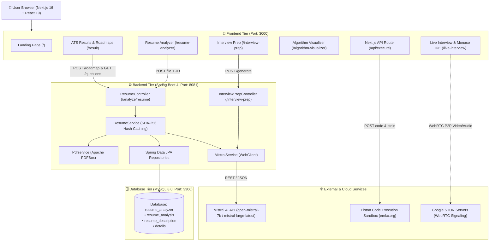

<div align="center">

# ⚡ CareerForge (Resume Analyzer & AI Career Suite)

### *The Unified AI-Powered Platform for Resume Auditing, Interview Mastery, Algorithm Visualization, and Real-Time Collaborative Mock Interviews*

[](https://nextjs.org/)
[](https://react.dev/)
[](https://spring.io/projects/spring-boot)
[](https://www.oracle.com/java/)
[](https://www.mysql.com/)
[](https://mistral.ai/)
[](https://tailwindcss.com/)
[](https://www.typescriptlang.org/)

---

</div>

## 📖 Table of Contents
1. [Overview](#-overview)
2. [System Architecture](#-system-architecture)
3. [Key Modules & Features](#-key-modules--features)
4. [Monorepo Directory Layout](#-monorepo-directory-layout)
5. [Prerequisites & Environment Setup](#-prerequisites--environment-setup)
6. [Quick Start Guide](#-quick-start-guide)
   - [1. Database Setup](#1-database-setup-mysql)
   - [2. Backend Setup](#2-backend-setup-spring-boot)
   - [3. Frontend Setup](#3-frontend-setup-nextjs)
7. [Environment Variables Reference](#-environment-variables-reference)
8. [API Endpoints Summary](#-api-endpoints-summary)
9. [Subsystem Documentation Links](#-subsystem-documentation-links)
10. [Troubleshooting & FAQ](#-troubleshooting--faq)

---

## 🌟 Overview

**CareerForge** is a full-stack AI career platform engineered to transform how software engineers prepare for technical recruitment. By pairing a high-performance **Spring Boot 4 / Java 17** backend with a modern **Next.js 16 / React 19** frontend and **Mistral AI**, CareerForge provides an end-to-end recruitment preparation workflow:

1. **AI Resume Analyzer & ATS Audit:** Strips uploaded PDF resumes via **Apache PDFBox**, matches them against target Job Descriptions, computes an ATS match score, identifies skill gaps, and stores results with SHA-256 caching.
2. **Interactive Learning Roadmaps:** Recursively generates personalized, multi-tiered roadmaps for missing skills.
3. **Targeted Interview Questions:** Generates 20 deep technical and behavioral questions tailored to the gap between your resume and the target role.
4. **Domain Interview Preparation:** Curated question generator covering Java, Spring Boot, SQL, DBMS, Operating Systems, Computer Networks, and HR interviews.
5. **Interactive Algorithm Visualizer:** Step-by-step sorting and searching animations with synchronized syntax-highlighted code execution and Big-O complexity cards.
6. **Live Technical Interview & Collaborative IDE:** Real-time WebRTC audio/video calling, synchronized Monaco code editor, and live code compilation across 8+ languages powered by the Piston Sandbox API.

---

## 🏛️ System Architecture



---

## 🚀 Key Modules & Features

| Module | Route | Capabilities | Tech Stack |
|:---|:---|:---|:---|
| **Resume Analyzer** | `/resume-analyzer` | Upload PDF resumes, enter target job description, measure client latency | Next.js, PDFBox, Spring Boot |
| **ATS Results & Roadmap** | `/result` | ATS radial score gauge, strengths, weaknesses, recursive learning tree, question generator | Recharts, Mistral AI, SHA-256 |
| **Interview Prep** | `/interview-prep` | Domain & topic drilldowns (Java, Spring, SQL, DBMS, OS, Networks, HR) with detailed answers & explanations | Mistral AI, React Accordion |
| **Algorithm Visualizer** | `/algorithm-visualizer` | Visualizer for Bubble, Selection, Insertion Sort, Linear & Binary Search with code line tracking & speed slider | HTML5 Canvas/CSS, React State |
| **Live Interview Room** | `/live-interview/[roomId]` | P2P video/audio conferencing, session stopwatch, Monaco code editor with live compiler | WebRTC, Monaco Editor, Piston API |
| **User Profile** | `/profile` | Tech role curriculums, skill gap radar, milestone badges, activity timeline | Context API, Tailwind CSS |

---

## 📁 Monorepo Directory Layout

```
Resume_Analyzer/
├── README.md                      # Master Unified Project Documentation (This File)
├── DATABASE.md                    # Comprehensive Database & Schema Guide
├── Ai_resume_analyzer/            # Backend: Spring Boot 4 Application
│   ├── README.md                  # Dedicated Backend Documentation
│   ├── pom.xml                    # Maven Configuration & Dependencies
│   ├── mvnw / mvnw.cmd            # Maven Wrapper
│   └── src/
│       ├── main/
│       │   ├── java/com/example/Ai_resume_analyzer/
│       │   │   ├── AiResumeAnalyzerApplication.java
│       │   │   ├── controller/    # ResumeController, InterviewPrepController
│       │   │   ├── dto/           # InterviewPrepRequest
│       │   │   ├── entity/        # ResumeAnalysis, ResumeDescription, Details
│       │   │   ├── repo/          # ResumeAnalysisRepository, ResumeRepo
│       │   │   └── service/       # ResumeService, MistralService, Pdfservice
│       │   └── resources/
│       │       └── application.properties # Server port, DB URL, AI model keys
│       └── test/
└── ai-frontend/                   # Frontend: Next.js 16 App Router Application
    ├── README.md                  # Dedicated Frontend Documentation
    ├── package.json               # Node Dependencies & Scripts
    ├── tsconfig.json              # TypeScript Configuration
    ├── app/                       # App Router Pages & API Routes
    │   ├── page.tsx               # Landing page
    │   ├── resume-analyzer/       # Upload form
    │   ├── result/                # ATS scores, roadmaps, questions
    │   ├── interview-prep/        # Domain interview prep generator
    │   ├── algorithm-visualizer/  # Sorting & searching visualizer
    │   ├── live-interview/        # WebRTC live interview room
    │   ├── profile/               # Career tracker & curriculum
    │   └── api/execute/           # Piston remote code compiler
    ├── components/                # Reusable UI & WebRTC components
    └── context/                   # AuthContext with JWT & session state
```

---

## 📋 Prerequisites & Environment Setup

Ensure the following tools are installed on your machine:

1. **Java Development Kit (JDK 17+)**:
   ```bash
   java -version
   ```
2. **Node.js (18.x or 20.x+) & npm**:
   ```bash
   node -v
   npm -v
   ```
3. **MySQL Server 8.0+**:
   ```bash
   mysql --version
   ```
4. **Mistral AI API Key**: Sign up at [console.mistral.ai](https://console.mistral.ai/) and generate an API key.

---

## ⚡ Quick Start Guide

### 1. Database Setup (MySQL)

Start your MySQL server and create the database:

```sql
CREATE DATABASE IF NOT EXISTS resume_analyzer
    CHARACTER SET utf8mb4
    COLLATE utf8mb4_unicode_ci;
```

> [!TIP]
> Hibernate will automatically generate all tables (`resume_analysis`, `resume_description`, `details`) on backend startup thanks to `spring.jpa.hibernate.ddl-auto=update`. To view the complete table definitions and indexing strategy, refer to [DATABASE.md](file:///c:/Users/gowtham/spring%20projects/aiproject/Resume_Analyzer/DATABASE.md).

---

### 2. Backend Setup (Spring Boot)

Open a terminal and navigate to the backend directory:

```bash
cd "Ai_resume_analyzer"
```

Set the required environment variables:

**Windows (PowerShell):**
```powershell
$env:MISTRAL_API_KEY="your_mistral_api_key_here"
$env:DB_PASSWORD="your_mysql_root_password"
```

**Linux / macOS (Bash):**
```bash
export MISTRAL_API_KEY="your_mistral_api_key_here"
export DB_PASSWORD="your_mysql_root_password"
```

Launch the Spring Boot server using the Maven wrapper:

```bash
# Windows
.\mvnw.cmd spring-boot:run

# Linux / macOS
./mvnw spring-boot:run
```

The backend will start on **`http://localhost:8081`**.

---

### 3. Frontend Setup (Next.js)

Open a second terminal and navigate to the frontend directory:

```bash
cd "ai-frontend"
```

Install NPM dependencies:
```bash
npm install
```

Start the Next.js development server:
```bash
npm run dev
```

Open your browser and navigate to **`http://localhost:3000`**.

---

## 🔐 Environment Variables Reference

| Component | Variable Name | Required | Default / Value | Description |
|:---|:---|:---:|:---|:---|
| **Backend** | `MISTRAL_API_KEY` | **Yes** | — | Secret API key to authenticate with Mistral AI |
| **Backend** | `DB_PASSWORD` | **Yes** | — | MySQL password for the `root` database user |
| **Backend** | `server.port` | No | `8081` | Spring Boot HTTP port |
| **Backend** | `spring.datasource.url` | No | `jdbc:mysql://localhost:3306/resume_analyzer` | JDBC connection string |
| **Frontend** | `PORT` | No | `3000` | Next.js server port |

---

## 📡 API Endpoints Summary

| Endpoint | Method | Source Component | Description |
|:---|:---:|:---|:---|
| `/analyze/resume` | `POST` | Spring Boot (`:8081`) | Ingests PDF resume & JD, performs ATS scoring and caching |
| `/analyze/resume/{id}/roadmap` | `POST` | Spring Boot (`:8081`) | Generates recursive learning roadmap for identified gaps |
| `/analyze/resume/{id}/questions` | `GET` | Spring Boot (`:8081`) | Generates 20 tailored interview questions for candidate |
| `/interview-prep/generate` | `POST` | Spring Boot (`:8081`) | Generates 20 questions with answers by domain and topic |
| `/api/execute` | `POST` | Next.js (`:3000`) | Executes code in 8+ languages via remote Piston sandbox |

---

## 📚 Subsystem Documentation Links

For in-depth architectural guides, class diagrams, schemas, and configurations, consult the individual documentation files:

- 🗄️ **Database Documentation:** [DATABASE.md](file:///c:/Users/gowtham/spring%20projects/aiproject/Resume_Analyzer/DATABASE.md)
  *Detailed ER diagrams, DDL scripts, column data dictionary, SHA-256 caching mechanism, and administration queries.*
- ⚙️ **Backend Documentation:** [Ai_resume_analyzer/README.md](file:///c:/Users/gowtham/spring%20projects/aiproject/Resume_Analyzer/Ai_resume_analyzer/README.md)
  *Spring Boot 4 architecture, service layers, Mistral AI prompt engineering, PDFBox stripping, and curl testing examples.*
- 🎨 **Frontend Documentation:** [ai-frontend/README.md](file:///c:/Users/gowtham/spring%20projects/aiproject/Resume_Analyzer/ai-frontend/README.md)
  *Next.js 16 App Router hierarchy, React 19 state architecture, Recharts radial gauge, Monaco code editor, WebRTC video calling, and Piston runner.*

---

## 🛠️ Troubleshooting & FAQ

### 1. `Communications link failure` on Backend Startup
- **Cause:** MySQL server is not running or the database credentials in `application.properties` do not match.
- **Solution:** Verify MySQL is active on port 3306, ensure database `resume_analyzer` exists, and confirm that `$env:DB_PASSWORD` matches your local MySQL password.

### 2. `Mistral API 401 Unauthorized` or `429 Rate Limited`
- **Cause:** Missing or invalid `MISTRAL_API_KEY`, or account quota exceeded.
- **Solution:** Check your key on the [Mistral Console](https://console.mistral.ai/) and verify it is exported in the terminal where you execute `./mvnw spring-boot:run`.

### 3. Frontend Displays: `Error connecting to the backend. Is your Spring Boot server running on port 8081?`
- **Cause:** The Next.js client attempted to contact `http://localhost:8081/analyze/resume` before the Spring Boot backend was started or while it was compiling.
- **Solution:** Ensure the Spring Boot backend has finished starting up and prints `Started AiResumeAnalyzerApplication in ... seconds`.

### 4. Code Execution Times Out in Live Interview Room
- **Cause:** Network connectivity issue reaching the public Piston Sandbox API (`https://emkc.org/api/v2/piston/execute`).
- **Solution:** Verify that your internet connection allows outgoing HTTPS requests to `emkc.org`.

---

<div align="center">
  <b>Built with ❤️ for aspiring engineers preparing for their dream technical roles.</b>
</div>
